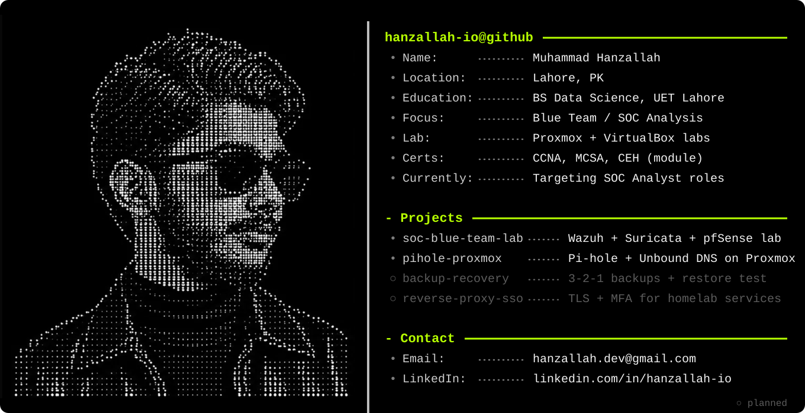

# Muhammad Hanzallah

**Blue Team · SOC Analyst** 
BS Data Science @ UET Lahore 🇵🇰

*Service running. Ruleset valid. Zero alerts.* 
**One field name was the bug.** [Read the story →](https://github.com/hanzallah-io/soc-blue-team-lab)

---

## 🔬 Featured Project

### [SOC Blue Team Lab](https://github.com/hanzallah-io/soc-blue-team-lab)

A multi-VM SOC lab built during a 90-day internship. 
It follows an attack through the full pipeline:

**Telemetry → Detection → Investigation** 
**→ Threat Intel → Incident Response → Forensics**

**90 days · Wazuh · Suricata · pfSense · Volatility 3 · MITRE ATT&CK · NIST SP 800-61**

Inside: a silent detection failure, a broken threat-intel integration, 
and a firewall that refused to boot. Each one is documented with the fix.

---

## 🏠[Homelab](https://github.com/hanzallah-io/homelab)

Self-hosted infrastructure on a **Proxmox VE** node, used to build, break and document real services.

| Project | What it does | Stack | Status |
| --- | --- | --- | --- |
| [**Pi-hole DNS**](https://github.com/hanzallah-io/homelab/tree/master/projects/01-proxmox-pihole-unbound) | Network-wide ad/tracker blocking with a local recursive resolver and curated blocklists | Debian LXC · Pi-hole · Unbound · HaGeZi · OISD | ✅ Live |
| **Backup & recovery** | 3-2-1 backups of all guests with a documented restore test | Proxmox Backup Server | 🔜 Planned |
| **Reverse proxy + SSO** | TLS and MFA in front of every self-hosted service | Nginx Proxy Manager · Authelia | 🔜 Planned |

**Write-up:** the Pi-hole build includes a post-mortem of a DNSSEC outage caused by a dead RTC battery and a DNS circular dependency, with the fix.

---

## 🧰 Tools I've Worked With

| | |
| --- | --- |
| **SIEM / Detection** |   |
| **Network** |   |
| **Threat Intel** |     |
| **Digital Forensics** |      Memory · Disk (`.E01`) · Browser artifacts · LNK & USB traces |
| **Frameworks** |   |
| **Platforms** |       |

---

## 🏆 Credentials

| | Credential | Issuer | 
| --- | --- | --- | 
| 🛡️ | **SOC Analyst Internship, Batch 2**: Certificate of Completion & Letter of Experience | Cyberster | 
| 🎓 | **Professional Diploma in Advanced Cybersecurity** (incl. CEH module) | PNY Training | 
| 🪟 | **MCSA** | PNY Training | 
| 🌐 | **CCNA** | Cisco | 

---

## 📬 Let's Connect

Open to **SOC Analyst internships and junior blue team roles**.

